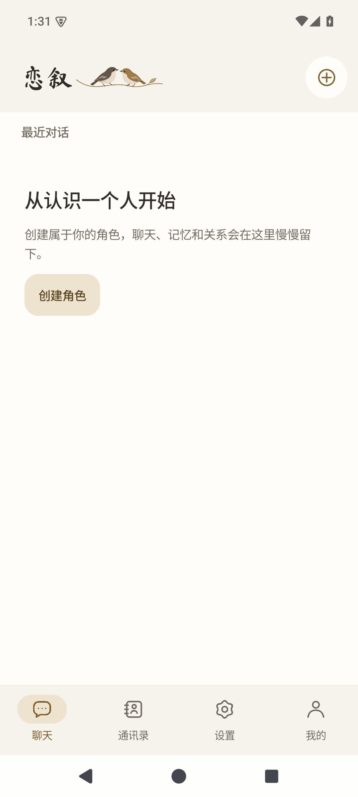
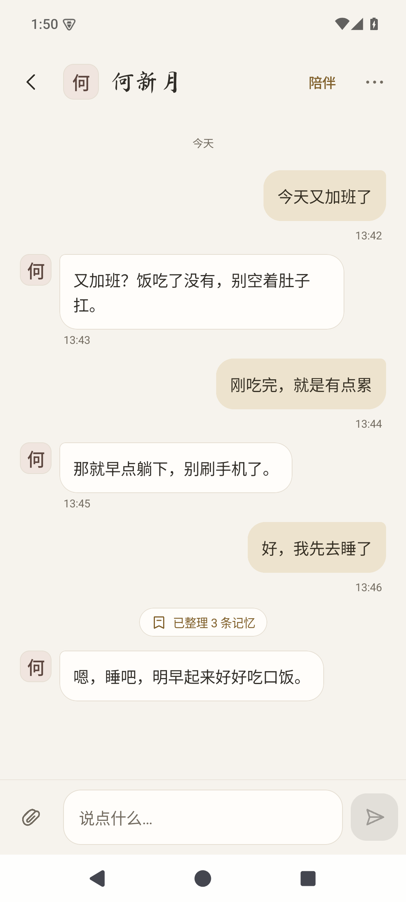
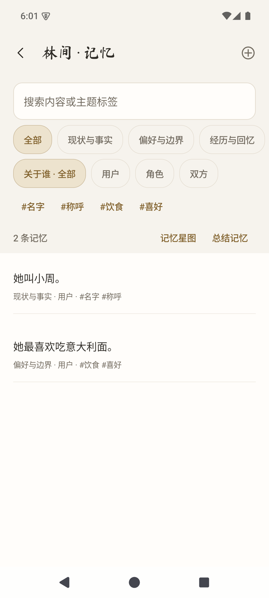

# 恋叙 · Lianxu

**和自己设定的角色聊天，聊过的东西会留下能翻看、也能改掉的记忆。**

恋叙是一款原生 Android 角色对话应用。角色、聊天、记忆和相处记录**全部存在手机本地**，调用哪家模型由你决定——只有发消息时，这段对话需要的上下文才会发给你自己配置的服务商。它不自带免费模型，也不把你绑在任何一家服务上。

**Android 8.0+ · Kotlin / Jetpack Compose / Material3 · 自备模型 API · GPL-3.0-only**

当前正式版 **1.0.0（版本号 59）**。安装包和校验值见 [GitHub Releases](https://github.com/Jiang-Xiaoxing/Lianxu/releases/tag/v1.0.0)；这一版改了什么、验证到哪一步、还有哪些没验，都写在 [1.0.0 更新说明](RELEASE-NOTES-1.0.0.md)里。

## 界面

<p>
  
  
  
</p>

## 它有什么不同

- **资料在你自己手里。** 聊天、记忆、关系存放在本机数据库，不上传任何第三方中转；需要联网的只有你自己配的那个模型接口。
- **服务商你自己换。** 内置硅基流动、DeepSeek、Moonshot、MiniMax 等预设，也可以直接填任何 OpenAI 兼容地址和自建服务。换服务商不影响已有角色和资料。
- **记忆看得见来源。** 每条记忆能查到它是从哪句原话来的，可以编辑、锁定、选择保留或作废；整理记忆不会删除原始聊天。
- **聊天和回顾分开。** 回复先显示，心情、关系与经历回顾在后台批量进行，失败也不会撤回已经说过的话。

## 现在能做什么

| | |
|---|---|
| **按角色聊天** | 每个角色有独立设定、会话和记忆。回复分段显示；等待时仍能输入和补发，新消息会停掉上一轮没说完的部分，已经显示的内容保留。 |
| **管理记忆** | 查看原话来源、编辑或锁定条目、处理待确认内容。来源变化后可以选择对应条目保留还是作废。 |
| **两个记忆工具分开开关** | 「主动回查」默认开启，「当场写记忆」默认关闭。是否真的调用取决于模型；只有写入成功才算保存。 |
| **后台回顾相处** | 默认累计 5 轮实际已显示的对话后回顾一次，可调整轮数。与长期记忆整理是两个流程。 |
| **主动联系（可选）** | 开启后角色可以按有效话题安排联系、回访或延后考虑。实际发送受权限、频率和 Android 后台限制，**不能保证准时送达**。 |
| **备份与诊断** | 导出单个角色或完整备份，导入前先预览会新增或覆盖什么。完整备份可另选是否包含 API 密钥，包含时用密码加密。 |

默认保留近期 **40 个完整回合**，每批整理 **20 回合**，相关记忆最多 **15 条**，核心记忆单独处理。这些数字可以在设置里调整，但最终仍受所用模型的真实上下文容量限制。

## 一段用起来是什么样

```text
写下角色的人设  →  开始聊天  →  她说「嗯…我记住了」
                              ↓
                    点开胶囊看她到底存了什么
                              ↓
              不对就改、不重要就删，来源原话还在
```

## 开始使用

1. **下载安装。** 从 [Releases](https://github.com/Jiang-Xiaoxing/Lianxu/releases/tag/v1.0.0) 下载 APK 并先读该版说明。升级前请先备份，**不要为了安装而卸载存有资料的旧应用**。
2. **添加模型。** 打开「设置 → 大模型配置」，填服务地址、模型名和你自己的 API 密钥，再为需要的用途选定模型。保存配置只是存好设置，不代表已经连上。
3. **创建角色。** 从添加入口创建角色，填好设定，发第一条消息。先确认文字聊天通了，再调整记忆和主动联系选项。

正式包名为 `app.lianxu.independent`，沿用公开 v0.19 的签名。包名或签名不同的安装包不能直接覆盖；自行编译的调试包（带 `.companionstage1` 后缀）与正式版分开保存数据。

## 从源码构建

需要 JDK 21 和兼容的 Android SDK。构建、单元测试、设备测试与测试证书的完整步骤见 [开发与测试](docs/DEVELOPMENT.md)。

```sh
./gradlew :app:assembleDebug :app:testDebugUnitTest :app:lintDebug
```

## 备份、隐私与边界

- **先备份再折腾。** 升级、换设备、导入覆盖之前都先导出一份。导入时先看预览。
- **密钥要单独保护。** 完整备份可以选择包含 API 密钥，包含时用备份密码加密密钥；聊天等其他资料不因这一项而加密。别把备份当可公开分享的文件。
- **看得见的限制，不粉饰。** 只支持文字消息，附件入口会提示「附件暂未接入」，没有图片、文件或语音聊天。真实服务商表现、真实手机和长期后台行为没有验收，合成测试不能证明真实模型表现得像真人。
- **诊断内容可能含隐私。** 详细诊断会包含聊天和提示词，提交问题前请先检查并去掉私人内容、密钥和凭据。

## 常见问题

**装好就能免费聊天吗？**
不能。需要自行配置可用的模型 API；开源不等于模型免费。

**保存了模型配置，为什么还是不回？**
保存配置不会发起请求。确认对应用途已选模型，再检查密钥、模型名、服务地址和额度。不要把密钥贴到公开 Issue 里。

**能保证记住所有事吗？**
不能。记忆工具、来源校验和人工编辑能帮你管理资料，但替代不了模型的理解能力。看到记错的内容，可以查来源、改掉，重要的还能锁定。

**能发图片或语音吗？**
当前版本只支持文字。

## 了解更多

- [1.0.0 更新说明](RELEASE-NOTES-1.0.0.md) — 这一版改了什么、验证了哪些、哪些还没验
- [架构说明](docs/ARCHITECTURE.md) · [界面设计](docs/UI-DESIGN.md) · [开发与测试](docs/DEVELOPMENT.md)
- 发现问题请在 [Issues](https://github.com/Jiang-Xiaoxing/Lianxu/issues)说明应用版本、Android 版本、复现步骤和预期/实际结果

## 许可

源码采用 [GPL-3.0-only](LICENSE)。第三方依赖、字体与资源的许可和署名见 [THIRD_PARTY_NOTICES.md](THIRD_PARTY_NOTICES.md)，分发时需保留。

仓库不包含发布私钥。自行构建的包只有使用兼容签名时才能覆盖已有安装。
