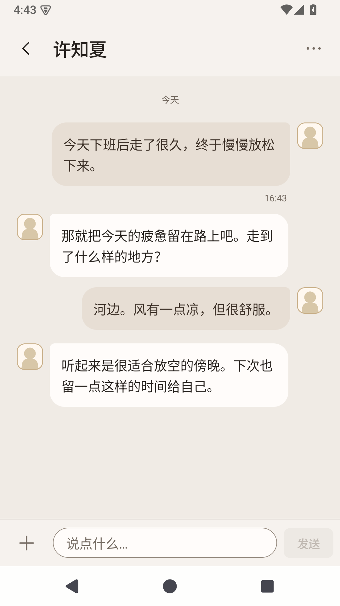
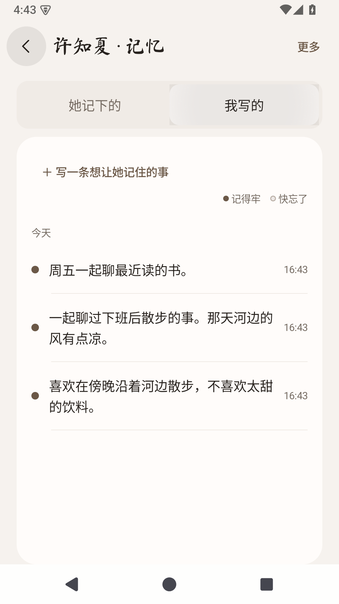
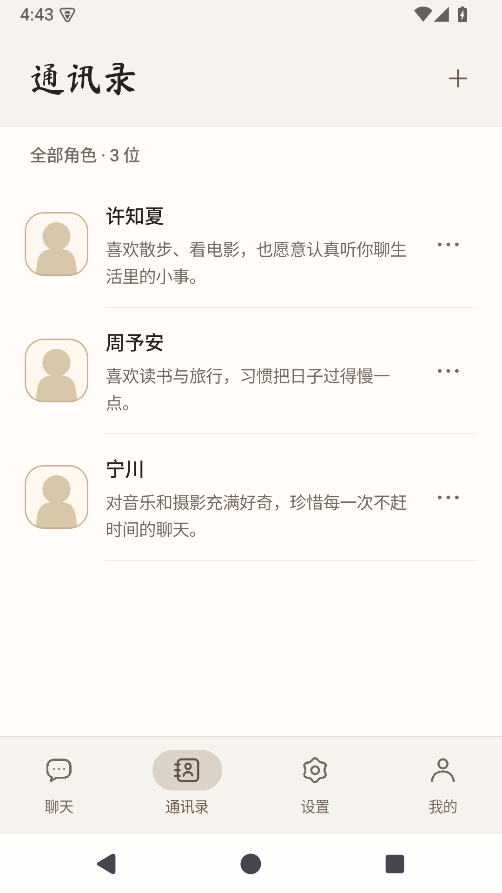
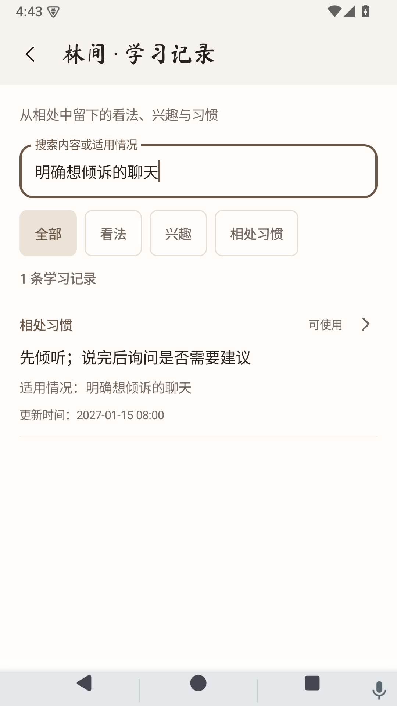
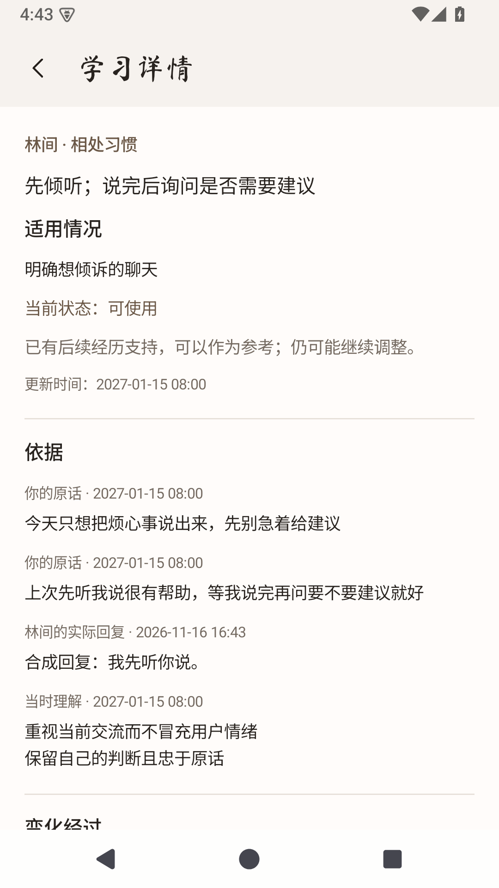

# 恋叙 · Lianxu

**和你设定的角色相处，让共同经历参与她下一次的理解、回应与选择。**

恋叙是一款开源的 Android 角色陪伴应用。你写下她的性格、背景和你们的关系，从聊天开始认识彼此。相处中发生的事、她曾经怎样理解和回应、你后来给出的反馈，都可以留下记录，成为之后交流的依据。她可以表达自己的看法，也可以在有依据的相处中逐渐调整兴趣与习惯。

当前正式版 **1.0.3**，支持 **Android 8.0 及以上**。使用时需要自行配置模型 API，费用由你选择的服务商收取。

[下载 APK](https://github.com/Jiang-Xiaoxing/Lianxu/releases/latest) · [这一版更新了什么](RELEASE-NOTES-1.0.3.md) · [开始使用](#开始使用) · [反馈问题](https://github.com/Jiang-Xiaoxing/Lianxu/issues)

  
  
  

*文中画面来自 1.0.3 在专用 Android 模拟器中的实际运行。角色、聊天和记忆为合成展示资料，聊天文字预先写入，用来展示界面。*

## 目录

- [从一次相遇开始](#从一次相遇开始)
- [共同经历怎样留下影响](#共同经历怎样留下影响)
- [她有自己的看法，也会慢慢改变](#她有自己的看法也会慢慢改变)
- [主动联系，也会考虑此刻是否合适](#主动联系也会考虑此刻是否合适)
- [记忆可以翻看、纠正和保护](#记忆可以翻看纠正和保护)
- [日常聊天中的细节](#日常聊天中的细节)
- [模型自己选，资料自己保管](#模型自己选资料自己保管)
- [开始使用](#开始使用)
- [当前的限制](#当前的限制)
- [更多资料](#更多资料)
- [许可](#许可)

## 从一次相遇开始

恋叙想把两件事做进日常对话里。一件是角色能保留自己的立场，另一件是你们相处过的事情能在以后继续产生影响。一次明确的拒绝、一次聊得投机的分享、一句“这样说让我舒服多了”，都值得在下一次交流时被认真对待。

第一次打开、还没有角色时，轻触门前的画面，就能进入创建引导。先起名字，写下角色设定，再选择是否补充你们的关系和其他细节。每一步都可以回头修改，最后确认后保存。

你可以直接使用自己写的文字，也可以让已配置的聊天模型帮忙润色。润色稿会先展示出来，供你检查、逐项修改或切回原文。在创建预览这一步，点“润色”才会把当前填写的资料发给聊天模型。已有角色时，首页加号仍提供完整的创建表单。

  

每个角色都有独立的设定、会话、记忆和相处记录。你也能填写自己的名字、称呼与介绍，让角色知道该怎样称呼你。

## 共同经历怎样留下影响

长时间相处，需要能接得上过去。聊过什么是一部分，当时如何理解、做过什么回应、后来有没有得到新的反馈，同样会影响下一次交流。

恋叙围绕这些内容组织记忆。最近的对话保留原文，较早的内容可以整理成长期记忆，相处中的理解、感受和变化另有记录。每次回复时，系统会结合当前话题和模型容量，从中选择仍然有效的材料交给模型。

### 原话留着，重要的内容逐步整理

近期聊天会直接参与对话。聊得更久以后，记忆整理会从较早的对话中提取值得保留的内容，包括个人信息、偏好与边界、共同经历、约定和待办。

整理出的条目保留对应的原话来源。你可以追到当时说了什么，也能发现一句话是否被理解错了。整理完成后，聊天原文仍保留在本机。整理失败时，尚未完成的对话会继续保留，应用会显示相应状态。

重要内容可以作为核心记忆单独安排，其他记忆按当前话题查找。除了文字匹配，系统也会参考已有依据的记忆关联。例如，同一件事的经过和后来的反馈，可以沿着关联一起被找到。还可以自行配置向量模型，帮助查找意思相近、用词不同的内容。

记忆还有清晰程度的变化。有些内容能提供细节，有些只剩大意或一点印象，过于模糊的条目会退出普通对话的相关记忆。重要程度会影响记忆随时间变淡的速度，后来有效地回想起一件事，或查到对应原话，这段记忆也有机会变得更清楚，往后淡得更慢。需要核实当时究竟说过什么时，还可以翻回聊天原话。

### 留下当时的理解，也接住后来的反馈

相处回顾会对照你当时的原话和她实际说过的内容，整理值得留下的理解、感受与回应方式。没有值得记下的内容时，那一轮可以留空。后来的反馈可以再指向之前的回应，说明它有没有帮上忙、是否被拒绝，或者还拿不准效果。

这些记录会参与之后可用材料的筛选。相关经历、当前有效的看法和习惯、近期关系状态，会与这次聊天一起交给模型，供它判断怎样接话。仍在尝试的习惯会标明状态，模型据此判断这次是否适用。

**共同经历的作用，会延伸到之后怎样理解你、怎样表达意见，以及是否再来联系你。** 具体回应仍由你选择的模型生成，理解质量与执行情况会影响最终体验。

### 一个说明情境

假设你说过，工作不顺时，希望先把事情讲完，再一起想办法。

这句话可以成为你的相处偏好。某次角色先听你讲完，你又明确说“这样就舒服多了”，这份反馈便有机会与当时的回应联系起来。之后再遇到相似话题，相关偏好、经历和已经形成的习惯就能作为参考，帮助角色选择先听、问清楚，或一起分析。

如果你这一次直接说“帮我列个办法”，当前请求也会进入判断。已经形成的习惯有自己的适用情境，角色需要结合眼前的话来理解。

*这是帮助理解机制的假设情境。实际能否形成对应记录、怎样回应，取决于模型与功能设置。*

### 想不起细节时，可以再翻原话

「主动回查」允许模型在需要时搜索记忆和历史聊天，默认开启。找到资料后，系统要求角色据实使用，并说明是翻过记录。资料不足时，表达规则要求它保留不确定性，避免补出没有依据的共同经历。

「当场写记忆」是另一个独立开关，默认关闭。开启后，模型可以在聊天中请求写入，应用会检查来源和保存结果。聊天里的记忆提示可以点开，查看这次实际记下或查到了什么。

## 她有自己的看法，也会慢慢改变

创建角色时写下的人设，包含身份背景、核心原则，也包含起初的兴趣和相处方式。恋叙为这些内容保留了不同的变化空间。

稳定的身份与明确原则构成角色的基础。观点、兴趣和习惯则可以随着有来源的交流逐步变化。她可以提出不同意见，也可以从一次交流里形成自己的判断，带着这个判断继续了解你。

新想法先作为候选留下。有了后续经历，它可能继续尝试、得到确认，也可能暂停。系统会记录变化适用于什么情境、依据哪些经历、后来如何调整，后续对话按当前有效状态使用。

  
  

*学习页中的时间、变化状态和对话均为合成示例，用来展示记录与依据的对应方式。*

你可以在角色的学习记录里查看这些内容。关系中的信任、亲近、心结等状态也有原话依据，供模型结合当前交流理解。相处回顾在后台按批次完成，所以页面中的感受和关系记录可能晚于最新几轮聊天。

如果一组旧关系分值已经查不清来由，应用会保留原话、暂停回顾，之后的交流以仍可核对的内容为依据。

这里的“自己的看法”和“成长”，指角色在模型与记忆机制支持下表现出的判断、兴趣和习惯变化。实际表现需要通过持续使用来观察。

## 主动联系，也会考虑此刻是否合适

你可以为角色开启主动联系。聊天中安排的回访、还想继续的话题、共同目标和角色兴趣，都能成为以后再考虑联系的材料。

到了再次考虑的时间，系统会把近期对话、有效经历、相处状态与联系缘由交给模型。模型可以决定现在发消息、晚一点再考虑、取消这次安排，或者保持安静。你给同一角色发来新消息后，较早那条消息留下的联系安排会停止用于发送，后续围绕新的交流重新处理。

这种主动联系可以接续具体的事。比如一段还没聊完的话题，或之前说好要回头问问的结果。角色过去形成的看法和习惯，也可以影响这次判断。

**主动联系需要你开启。模型执行、网络和 Android 后台运行会影响何时考虑联系，无法保证准时发送或送达。** 通知权限会影响手机是否显示通知，关闭通知后，消息仍可能出现在应用内。当前还存在模型口头答应联系却没有真正安排的情况。

## 记忆可以翻看、纠正和保护

记忆管理里能看到她记下的内容，也能看到你自己补充的内容。你可以查看来源、修改条目、锁定重要内容，处理需要确认的记录。

修改或撤回原话后，角色会停止使用依赖旧原话的记忆。你可以保留条目供核对，也可以将未受保护的条目标为作废。人工维护和锁定的内容有专门的保护规则，涉及来源变化或整理冲突时，会留下需要核对的记录。

聊天中的“我记住了”等提示也能展开查看，方便你确认实际保存了什么。若要忘记一件事或纠正理解，可以在聊天中提出，随后检查处理结果。遗忘成功后，她会停止使用选中的经历，你仍可以在聊天记录里看到原话。当前口头遗忘仍可能选错首次处理的目标，重要内容建议到记忆页面核对。

## 日常聊天中的细节

- **回复分段出现。** 角色可以按几段消息接话。等待时，你仍能继续输入和补充，新消息会停下上一轮尚未说完的部分，已经显示的内容保留。
- **回顾在后台进行。** 已经显示的回复先留在聊天里，相处回顾随后按设置批次处理。长聊所需的记忆整理有独立流程，遇到容量不足时会提示等待整理或调整配置。
- **时间与约定有上下文。** 她能参考当前时间和之前消息的发送时间，理解“过一会儿”或“明天再聊”。如果聊天中确实安排了回访，后台再次考虑联系时，还会参考当时约的时间和缘由。是否真正安排成功仍需看处理结果。
- **自己的资料可以调整。** 名字、称呼、自我介绍和角色设定都能修改，后续交流使用已保存的设置。

## 模型自己选，资料自己保管

### 选择适合自己的模型

恋叙提供硅基流动、DeepSeek、Moonshot、MiniMax 等服务商预设，也支持填写兼容的自定义服务地址。你可以为聊天和记忆整理选择模型，未另选记忆模型时沿用聊天模型。向量检索也有独立配置。

更换服务商以后，本机已有角色、聊天和记忆仍然保留。不同模型在表达、理解、工具调用和价格上各有差异，实际能力需要用自己的配置确认。仅保存配置代表设置已存好，连接测试与实际聊天有各自结果。

### 本地保存与联网处理

角色、聊天、记忆和相处记录保存在手机本地。需要模型处理时，对应功能会向你配置的服务商发送所需内容。例如，聊天会使用当前对话及选入的相关资料，回顾和整理会使用对应范围的记录，润色会使用当前填写的角色资料，向量检索会使用待索引或查询的文本。

开启主动联系后，应用也可能在后台把角色设定、近期聊天和联系缘由交给聊天模型。即使她决定这次保持安静，这次判断也可能产生费用。

**本地保存与模型处理时的外发同时存在。** 请根据自己的隐私需求选择服务商，并了解它的数据处理方式。聊天、后台回顾、整理、润色以及已启用的向量检索都可能产生模型费用，开源应用本身不附赠免费模型额度。

### 导出、迁移和备份

可以导出单个角色，也可以做完整备份。导入前先看预览，确认哪些资料会新增、哪些会覆盖。升级、换手机和导入覆盖前，建议先留一份备份。

恢复备份后，模型选择和密钥需要再检查。从备份恢复的角色需要重新开启主动联系，备份里尚未执行的回访安排会停止发送。

完整备份可以选择是否包含 API 密钥。选择包含时，密钥部分用备份密码加密。聊天、记忆和角色资料以可直接读取的形式保存在备份里，拿到文件的人可以查看这些内容。分享角色或提交问题前，请检查文件中是否带有私人聊天和凭据。

## 开始使用

1. **安装应用。** 从 Releases 下载 APK，阅读该版本说明。升级前先导出备份，保留旧应用直接覆盖安装，**不要先卸载存有资料的旧应用**。[下载与版本说明](https://github.com/Jiang-Xiaoxing/Lianxu/releases/latest)
2. **创建或恢复角色。** 首次进入时轻触开门，新用户选择创建角色，按步骤填写设定。换机用户先从备份恢复资料，导入前检查新增或覆盖的范围。
3. **确认模型可用，开始聊天。** 在创建引导或「设置 → 大模型配置」中填写服务地址、模型名和自己的 API 密钥，并选择聊天模型。恢复过备份的用户也请检查选择和密钥。先完成连接测试，再试一次文字聊天，之后按需要调整记忆和主动联系选项。

安装身份与记忆默认设置

正式版包名为 `app.lianxu.independent`，沿用上一正式版的签名。包名或签名不同的安装包无法直接覆盖原应用。自行编译的调试包带 `.companionstage1` 后缀，与正式版分开保存资料。

默认超过 40 轮后开始整理较早的对话，每批取 20 轮，相关记忆最多选取 15 条，核心记忆单独处理。尚未整理的原话会继续保留在近期输入里。相处回顾默认累计 5 轮有已显示回复的聊天后进行，被打断前已经显示并保存了部分回复，也算一轮。这些设置可以调整，最终仍受所用模型的真实容量限制。

## 当前的限制

- **目前支持文字聊天。** 图片、文件和语音消息尚未接入，附件入口会显示提示。
- **模型可能理解错、漏记或执行失败。** 记忆、成长和关系记录依赖实际模型返回，重要内容可以查来源并手动纠正。当前还存在口头遗忘首次选错目标、答应联系却漏安排的问题。
- **长期体验仍需继续验证。** 1.0.3 的验证使用专用模拟器、合成数据和模拟客户端。真实服务商润色、真实手机、锁屏通知及长期省电后台尚未验收，测试范围与已知问题保留在版本验证记录中。[1.0.3 验证记录](VALIDATION-1.0.3.md)
- **诊断文件可能包含隐私。** 详细诊断可能包含聊天和提示词，公开反馈前请检查并去除私人内容、密钥和其他凭据。

## 更多资料

- [1.0.3 更新公告](RELEASE-NOTES-1.0.3.md) · [历史版本](https://github.com/Jiang-Xiaoxing/Lianxu/releases)
- [开发与测试](docs/DEVELOPMENT.md) · [界面设计](docs/UI-DESIGN.md)
- 历史架构说明保留了公开 v0.19 时的设计记录。当前实现请结合源码和对应版本公告阅读。[历史架构说明](docs/ARCHITECTURE.md)
- 反馈时请写明应用版本、Android 版本、操作步骤，以及预期和实际发生的情况。[提交 Issue](https://github.com/Jiang-Xiaoxing/Lianxu/issues)

## 许可

恋叙使用 Kotlin、Jetpack Compose 与 Material3 开发。源码采用 GPL-3.0-only，第三方依赖、字体和资源的许可与署名请一并保留。[源码许可](LICENSE) · [第三方致谢](THIRD_PARTY_NOTICES.md)
